# ⚡ Awesome Command Line Utilities

  

  
  
  
  
  
  

---

## 📖 Table of Contents

- [🌐 Sector Overview & Market Dynamics](#-sector-overview--market-dynamics)
- [💼 SaaS & Hosted Platforms](#-saas--hosted-platforms)
- [🚀 Open-Source GitHub Projects](#-open-source-github-projects)
- [🤝 How to Contribute](#-how-to-contribute)
- [💖 Support](#-support)
- [⭐ Star History](#-star-history)
- [📜 Disclaimer](#-disclaimer)

---

## 🌐 Sector Overview & Market Dynamics

The developer productivity software market is valued at approximately **$45B to $52B** globally (growing at ~12–14% CAGR), with terminal and command-line developer tooling experiencing an aggressive modernization supercycle fueled by Rust/Go tool rewrites and AI-native agent integrations.

The sector is **moderately fragmented**: foundational operating systems and cloud package managers exhibit clear consolidation, while specialized terminal emulators, fuzzy interactive search engines, and prompt orchestrators remain open, highly competitive, and community-driven rather than winner-take-all.

---

## 💼 SaaS & Hosted Platforms

A curated comparison of notable commercial and hosted platforms powering command-line workflows, terminal emulation, launchers, and developer automation.

| Product | Description | Starting Pricing Tier | Free Tier Limits | Company Valuation / Scale |
| :--- | :--- | :--- | :--- | :--- |
| **[Warp](https://www.warp.dev/)** ⚡ | Modern AI-integrated terminal built in Rust with AI command suggestions and agentic workflows. | **$18/user/month** (Team Tier) | **Free forever plan** with core terminal features, unlimited local commands, BYO AI inference key support, and 100 Warp AI requests/month. | **~$200M – $300M** (Series B, $50M round led by Sequoia Capital) |
| **[Raycast](https://www.raycast.com/)** 🚀 | Fast, keyboard-first launcher & productivity command-line companion across macOS & Windows. | **$10/user/month** billed annually (Pro Tier) | **Free forever plan** with core app launcher, 1,000+ store extensions, custom quicklinks, system controls, and calculator/conversions (AI features excluded). | **~$120M** (Series B, $30M led by Atomico & Accel) |
| **[Setapp](https://setapp.com/)** 📦 | Subscription suite granting unified access to 240+ curated developer and system Mac/iOS utilities. | **$14.99/month** (Single Mac) | **7-day free trial** with full, unrestricted access to the entire 240+ application library (no ongoing free forever tier). | **~$90M+ annual revenue** (Parent MacPaw bootstrapped; internal target $1B+) |
| **[Termius](https://termius.com/)** 🔒 | Cross-platform SSH client, SFTP navigator, and encrypted credential vault across desktop and mobile. | **$10/user/month** billed annually (Pro Tier) | **Free forever plan (Starter)** limited to local device vault only, basic SSH/SFTP terminal, no multi-device cloud synchronization or team vaults. | **~$3M – $4M ARR** (~$4.2M venture funding from Y Combinator & Initialized) |
| **[Chocolatey](https://chocolatey.org/)** 🍫 | Windows machine package manager providing automated software deployment and lifecycle management. | **$16/machine/year** (Chocolatey for Business, min order applies) | **Free forever open-source CLI (FOSS)** with community repository access, local client management, without centralized reporting or endpoint enforcement. | **~$1.7M+ ARR** (Bootstrapped enterprise spin-off; ecosystem partner with Puppet) |
| **[Alfred](https://www.alfredapp.com/)** 🎩 | Renowned macOS keystroke launcher, automated clipboard history manager, and deep script orchestrator. | **£34 (~$43) one-time** (Single User Powerpack v5) | **Free forever basic edition** with local app search, file discovery, web bookmarks, and system execution; workflows & clipboard history require Powerpack. | **Profitable indie software** (Running with Crayons Ltd; £500k+ balance sheet assets) |
| **[Homebrew](https://brew.sh/)** 🍺 | The premier community package manager for macOS and Linux powering millions of command-line developer setups. | **100% Free / Optional Sponsorship** (from $5/month) | **Completely free without limits**; open community-funded model through Open Collective and GitHub Sponsors. | **~$102k annual budget** ($150k+ balance sheet managed via Open Collective) |

---

## 🚀 Open-Source GitHub Projects

The following modern open-source command-line utilities, fuzzy searchers, shell prompts, and terminal accelerators are ranked by community GitHub stargazers count:

- **[The Fuck](https://github.com/nvbn/thefuck)**  — Magnificent console app which corrects errors in your previous console commands automatically.
- **[uv](https://github.com/astral-sh/uv)**  — An extremely fast Python package and project manager written in Rust, replacing pip, pip-tools, and poetry.
- **[fzf](https://github.com/junegunn/fzf)**  — Blazing-fast interactive command-line fuzzy finder for files, processes, and command history.
- **[lazygit](https://github.com/jesseduffield/lazygit)**  — Simple, fast, and feature-complete terminal UI for git commands and branch management.
- **[Tabby](https://github.com/Eugeny/tabby)**  — A terminal for a more modern age: cross-platform terminal and SSH client with serial connection and SFTP.
- **[ripgrep](https://github.com/BurntSushi/ripgrep)**  — Fast line-oriented search tool that recursively searches current directories for regex patterns.
- **[Alacritty](https://github.com/alacritty/alacritty)**  — Cross-platform, OpenGL GPU-accelerated terminal emulator designed for pure raw speed.
- **[ghostty](https://github.com/ghostty-org/ghostty)**  — Fast, feature-rich, and native cross-platform terminal emulator written in Zig.
- **[Bat](https://github.com/sharkdp/bat)**  — A `cat` clone with rich syntax highlighting, git integration, line numbers, and pager support.
- **[Starship](https://github.com/starship/starship)**  — The minimal, blazing-fast, and infinitely customizable prompt for any shell.
- **[tmux](https://github.com/tmux/tmux)**  — Terminal multiplexer enabling multiple terminal sessions, windows, and persistent background shells.
- **[fd](https://github.com/sharkdp/fd)**  — Simple, fast, and user-friendly alternative to `find` with colorized output and parallel traversal.
- **[Nushell](https://github.com/nushell/nushell)**  — A new type of shell that views your command output as structured tables rather than raw text streams.
- **[Zoxide](https://github.com/ajeetdsouza/zoxide)**  — A smarter `cd` command inspired by z and autojump, remembering frequently and recently used folders.
- **[HTTPie](https://github.com/httpie/cli)**  — Human-friendly CLI HTTP client with formatted JSON outputs, persistent sessions, and intuitive syntax.
- **[jq](https://github.com/jqlang/jq)**  — Lightweight and flexible command-line JSON processor and stream transformer.
- **[Kitty](https://github.com/kovidgoyal/kitty)**  — Cross-platform, fast, feature-rich, GPU-based terminal emulator supporting tabs and image rendering protocols.
- **[k9s](https://github.com/derailed/k9s)**  — Kubernetes CLI terminal dashboard to monitor, manage, and debug cluster resources in real time.
- **[fish-shell](https://github.com/fish-shell/fish-shell)**  — Smart, user-friendly interactive command-line shell with autosuggestions and web configuration out-of-the-box.
- **[delta](https://github.com/dandavison/delta)**  — A syntax-highlighting pager for git, diff, and grep output with side-by-side split diffs.
- **[Atuin](https://github.com/atuinsh/atuin)**  — Magical shell history backed by SQLite with end-to-end encrypted synchronization across machines.
- **[WezTerm](https://github.com/wez/wezterm)**  — GPU-accelerated cross-platform terminal emulator and multiplexer configured via Lua.
- **[Hyperfine](https://github.com/sharkdp/hyperfine)**  — Command-line benchmarking tool with statistical analysis, warmup runs, and export options.
- **[Winget CLI](https://github.com/microsoft/winget-cli)**  — The official Windows Package Manager client enabling discovery and installation of applications.
- **[Fastfetch](https://github.com/fastfetch-cli/fastfetch)**  — Lightning-fast, feature-packed system information fetch utility written in C.
- **[Eza](https://github.com/eza-community/eza)**  — Modern, maintained replacement for `ls` with tree views, icons, git status, and colored output.
- **[yq](https://github.com/mikefarah/yq)**  — Portable command-line YAML, JSON, XML, CSV, and TOML processor with jq-compatible syntax.
- **[xh](https://github.com/ducaale/xh)**  — Friendly and fast tool for sending HTTP requests, written in Rust with native HTTP/2 support.
- **[sd](https://github.com/chmln/sd)**  — Intuitive `find & replace` CLI tool alternative to sed with standard regex syntax.
- **[Tealdeer](https://github.com/dbrgn/tealdeer)**  — Very fast implementation of `tldr` in Rust providing practical, example-based cheat-sheets for commands.
- **[The Bleep](https://github.com/stamparm/thebleep)**  — Safe-by-default successor to The Fuck that asks before executing suggested command fixes.

---

## 🤝 How to Contribute

Contributions are warmly welcomed! Help keep this command-line utilities list comprehensive, fresh, and accurate:

1. 🍴 **Fork** the repository.
2. 🌿 Create a new branch: `git checkout -b feature/add-new-cli-tool`.
3. 📝 Add or edit your entry in [README.md](file:///C:/Users/ishan/Documents/Projects/Awesome-Command-Line-Utilities/README.md).
   - For SaaS tools: Specify exact starting prices, free tier limits, and company scale.
   - For Open-Source tools: Link repository and add a social star badge linking to `/stargazers`.
4. 🚀 Push your branch and open a **Pull Request** with a brief summary of the utility.

---

## 💖 Support

If you found this curated list helpful for supercharging your terminal environment, please consider supporting the project:

- ⭐ **Star** this repository to help others discover it.
- 🍴 **Fork** and share it with fellow developers and system administrators.
- ☕ **Buy a coffee & sponsor**: Visit the [GitHub Sponsors Dashboard](https://github.com/sponsors/ishandutta2007) to support continuous maintenance!

---

## ⭐ Star History

---

## 📜 Disclaimer

- This is a community-curated list for educational and productivity purposes.
- Command-line utilities handling credentials, shell configurations, and remote sessions must strictly follow system security best practices.
- All product names, logos, and brands are property of their respective owners.
